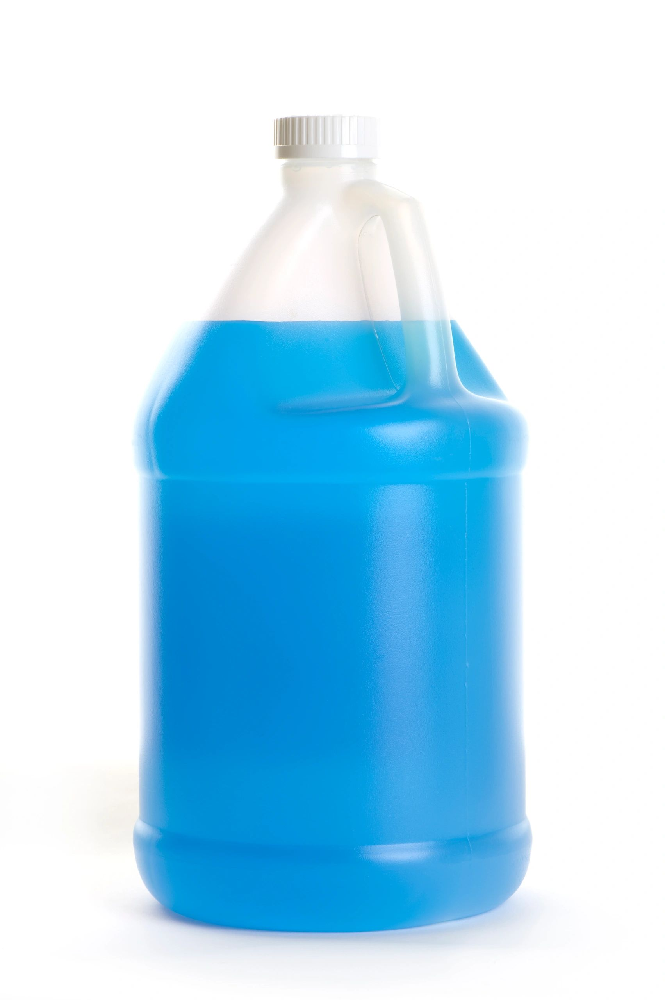

# Bulk Windshield Washer Fluid: Evolved 6-55 vs 32-1760

- **Published:** May 5, 2026, 11:36 PM Central (2026-05-06T04:36:10.899Z UTC)
- **Original URL:** https://www.evolvedproducts.us/blog/f/bulk-windshield-washer-fluid-evolved-6-55-vs-32-1760
- **Summary (meta description):** Unlocking Efficiency: Why Bulk Windshield Washer Fluids Matter
- **Featured image:** https://img1.wsimg.com/isteam/getty/157506595

---

<!-- IMAGE 1: original https://img1.wsimg.com/isteam/getty/157506595 -->

## Unlocking Efficiency: Why Bulk Windshield Washer Fluids Matter

In today’s fast-paced commercial operations, maintaining clear visibility is essential for safety and productivity. Bulk windshield washer fluids not only streamline maintenance routines but also offer significant cost savings and reduced environmental impact. Designed for heavy-duty usage in fleet management, these products deliver consistency and enhanced cleaning performance, ensuring that each vehicle meets safety and operational standards.

Choosing the right product line can transform your maintenance strategy by addressing common issues such as stubborn grime, rapid evaporation, and inefficient application methods. Here’s why transitioning to bulk solutions could be a game-changer:

- *Enhanced Operational Efficiency:* Bulk purchases reduce frequent reordering and manage inventory seamlessly.
- *Cost-Effective Maintenance:* Concentrated formulas go further, cutting down overall expenses.
- *Improved Safety Standards:* Reliable cleaning performance ensures safer driving conditions in both urban centers and rural routes.

This guide will explore practical tips on selecting the ideal product, understanding dilution ratios, and implementing maintenance schedules that optimize fluid performance. By incorporating these insights, professionals can strengthen operational reliability and ensure vehicles meet rigorous industry standards while catering to local conditions and climatic variations.

## Evolved 6-55: Elevating Efficiency for Moderate Operations

Discover the refined capabilities of the Evolved 6-55 formula, designed with moderate-scale operations in mind. This innovative concentrate stands apart by delivering a balanced blend of high-performance cleaning and cost-effective usage management. Engineered to tackle everyday windshield contaminants, the 6-55 formula is optimized to meet the practical needs of regional fleet managers and local service providers while maintaining an eco-conscious footprint.

Key features include:

- **Robust Cleaning Power:** Efficiently dissolves road grime and debris, ensuring enhanced visibility under varying environmental conditions.
- **Optimized Dilution Efficiency:** A little product goes a long way, making it ideal for moderate-scale applications where cost management and consistent performance are crucial.
- **Adaptability to Local Conditions:** Whether operating in urban centers or rural areas, the formulation is designed to perform reliably across diverse weather conditions and geographical regions.

Practical applications of the Evolved 6-55 are ideal for businesses seeking a scalable solution that improves operational efficiency without compromising on environmental responsibility. Embrace a formula that not only simplifies maintenance for moderate-scale operations but also supports sustainable practices in your local community.

## Powering Large-Volume Demands with the 32-1760 Formula

For operations that demand high efficiency in vast quantities, the 32-1760 formula stands out as a powerhouse solution. Designed specifically to address the challenges of large-scale applications, this formula delivers consistent, high-performance cleaning even in high-volume settings. Its concentrated design means that a little goes a long way, streamlining your inventory and reducing overall costs.

Key advantages include:

- **Robust Performance:** The unique chemical composition ensures superior grime removal, keeping windshields clear even under heavy road use.
- **Cost Efficiency:** Dilution capabilities allow for significant cost savings on bulk purchases, as a minimal amount produces extensive cleaning power.
- **Operational Consistency:** Engineered for repetitive high-volume tasks, the formula maintains its effectiveness across various climates, whether in urban centers or local regional hubs.
- **Ease of Use:** Simplifies maintenance routines by reducing the need for frequent reapplications, which is crucial in fast-paced, large-scale operations.

By focusing on this advanced formula, fleet managers and service professionals can achieve optimal cleaning performance while maintaining a streamlined approach to inventory management and operational efficiency. This innovative solution is a reliable choice for ensuring pristine visibility and sustained productivity over extended use.

## Unmatched Flexibility for Every Summer Adventure

Experience the power of engineered solutions that adapt to seasonal challenges while delivering exceptional visibility and performance during summer drives. Advanced windshield fluid formulations are crafted with modern technological insights to overcome the harsh effects of summer heat and intermittent rain. These products not only clean effectively but also adapt to different weather and environmental conditions, ensuring clear and streak-free visibility for both urban and rural drivers.

Key advantages include:

- **Enhanced Cleaning Efficiency:** Specialized additives break down stubborn grime and bug residue, even in high temperatures.
- **Adaptive Performance:** Engineered to resist rapid evaporation, these fluids maintain optimal performance during prolonged exposure to the sun.
- **Localized Benefits:** Perfect for urban areas experiencing heavy traffic and suburban regions facing sudden summer downpours, ensuring safety on every road.

For professional fleet managers or individual drivers, understanding the importance of seasonal maintenance routines can lead to improved road safety and vehicle longevity. Embracing these versatile formulations not only streamlines routine upkeep but also minimizes environmental impact. By tailoring application methods and properly diluting solutions, users can achieve the best results, regardless of regional weather variations or local driving conditions.

## Unlocking the Benefits: A Detailed Formula Comparison

When evaluating bulk windshield washer fluids, understanding the nuances between Bio, Bug, and Rain formulas is essential for diverse climates and applications. Each formulation is engineered to cater to specific challenges encountered in urban centers, rural areas, and regions with extreme weather conditions.

• Bio Formula:

- Crafted with sustainable, plant-based ingredients.
- Excels at breaking down organic grime and maintaining performance in moderate to intense heat.
- Ideal for areas where eco-conscious practices and cost efficiency are priorities.

• Bug Formula:

- Designed to tackle stubborn insect residues and road grime effectively.
- Provides enhanced clarity by rapidly dissolving bug deposits without leaving streaks.
- Particularly useful in suburban settings where insect activity is prominent throughout the summer.

• Rain Formula:

- Optimized for rapid dispersion even during heavy downpours.
- Features enhanced wetting properties to prevent streaking under high moisture conditions.
- A reliable choice in regions prone to sudden storms and consistent rain.

By considering these objective comparisons, businesses can select the most appropriate bulk windshield washer fluid formulation to address local climatic challenges and specific cleaning needs efficiently.

## Concluding Insights for Optimal Fluid Efficiency

Choosing the right bulk windshield washer fluid is more than a maintenance decision—it’s a strategic move that boosts operational efficiency and supports a cleaner environment. Throughout this guide, we’ve explored how selecting the proper formulation can enhance cleaning performance, reduce overall costs, and contribute to sustainability goals. A well-chosen fluid not only adapts to local weather challenges but also minimizes chemical waste, ensuring a safer, more efficient driving experience across urban and rural settings.

Key practical steps include:

- **Evaluate Your Needs:** Consider vehicle usage patterns and climatic conditions to ensure the fluid meets specific performance demands.
- **Adopt a Sustainable Approach:** Embrace eco-friendly formulations to benefit both operational outcomes and the local environment.
- **Regular Maintenance:** Integrate routine checks into your maintenance schedule to optimize fluid performance and longevity.

By integrating these actionable strategies, you can enhance visibility, safety, and cost control. Continue exploring improved options for windshield fluid, and remember that every proactive step taken today brings you closer to streamlined operations and long-term benefits. Your commitment to smart choices now lays the groundwork for a more efficient and sustainable future.
