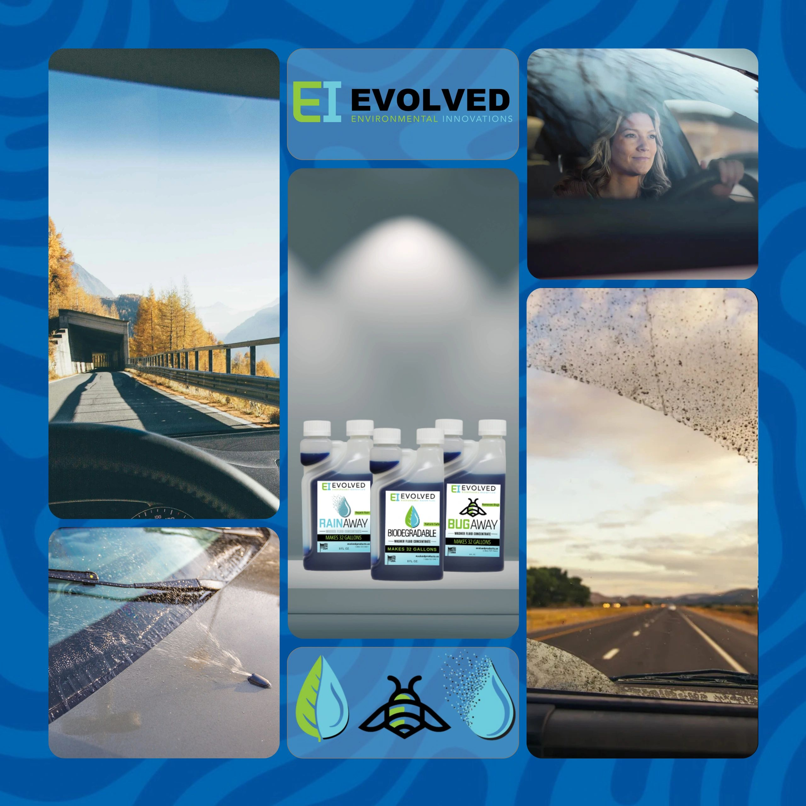

# Evolved 8-32 Windshield Washer Fluid: The Smart Choice for Summer

- **Published:** February 21, 2026, 3:00 AM Central (2026-02-21T09:00:19.399Z UTC)
- **Original URL:** https://www.evolvedproducts.us/blog/f/evolved-8-32-windshield-washer-fluid-the-smart-choice-for-summer
- **Summary (meta description):** Revolutionizing Your Summer Drive
- **Featured image:** https://img1.wsimg.com/isteam/ip/a58e4fe4-3671-424d-8ed5-5f1af74e791a/Washer%20Fluid%20Flyer.png

---

<!-- IMAGE 1: original https://img1.wsimg.com/isteam/ip/a58e4fe4-3671-424d-8ed5-5f1af74e791a/Washer%20Fluid%20Flyer.png -->

## Revolutionizing Your Summer Drive

Imagine a season where every drive is enhanced by clarity and precision—thanks to advanced windshield washer fluid concentrates that are engineered for the summer heat. This innovative approach rethinks traditional cleaning fluids by leveraging concentrated formulations that maximize efficiency while minimizing waste. With a focus on eco-friendly cleaning, these breakthrough solutions offer drivers a smarter choice for maintaining immaculate visibility during scorching summer days.

The new breed of concentrates is tailored to address common challenges such as stubborn grime and rapid evaporation under high temperatures. Key benefits include:

- *Enhanced Performance:* Concentrated formulas deliver deeper cleaning power while efficiently cutting through dirt and debris.
- *Environmental Advantages:* Reduced packaging and lower chemical loads contribute to greener maintenance practices.
- *Cost-Effective Use:* Dilution capabilities extend the life of your product, saving resources and money.

Throughout this guide, you’ll discover practical tips on how to optimize your car care routine, learn techniques for maintaining crystal-clear windshields, and explore actionable strategies to boost both safety and sustainability. Whether you're navigating urban streets or suburban routes, upgrading to these advanced concentrates offers a reliable solution to meet your summer driving needs.

## Maximizing Efficiency with Concentrated Formulas

Concentrated windshield washer fluids offer a range of advantages that go beyond traditional formulations. By harnessing the power of advanced, plant-based concentrates, these innovative solutions provide enhanced performance while minimizing environmental impact. Users quickly notice how the efficiency of dilution—not only leads to a longer-lasting product—but also reduces the frequency of repurchases over time.

Key benefits include:

- **Cost-Effectiveness:** A little goes a long way, significantly lowering operating costs compared to conventional fluids.
- **Enhanced Performance:** Concentrated formulas are designed to effectively cut through grime and road grime, especially in urban and suburban settings.
- **Eco-Conscious Impact:** With fewer chemicals used overall, these formulas support cleaner water systems and reduce waste—an important consideration for communities focused on sustainability.
- **Versatility in Local Conditions:** Whether facing summer heat or regional climatic challenges, the adaptability of these concentrates ensures optimal performance in various environments.

For drivers and service professionals in bustling metropolitan areas or small towns alike, embracing concentrated formulations translates into practical savings, improved cleaning power, and a commitment to responsible environmental practices—all making a notable impact on everyday windshield care.

## Bio-Powered Efficiency for Summer Driving

The innovative 8-32 Bio formula stands apart as a leader in eco-friendly windshield cleaning solutions. With its USDA Certified Biobased status, this advanced washer fluid harnesses the power of sustainable ingredients to meet modern environmental standards without compromising on performance. Designed to excel in the heat of summer, its composition ensures robust cleaning even during the most challenging weather conditions, keeping your windshield clear and safe.

Key benefits include:

- **Enhanced Visibility:** Effectively dissolves road grime and bug residue for superior clarity.
- **Eco-Conscious Design:** The biobased formulation minimizes reliance on synthetic chemicals, aligning with sustainable practices.
- **Reliable Temperature Performance:** Engineered to handle high temperatures, ensuring consistency and reliability throughout your summer travels.

Local drivers and fleet managers in many regions can appreciate the practicality of this formulation for maintaining safety and performance. By focusing on both environmental stewardship and high efficacy, the 8-32 Bio formula provides actionable benefits for daily use. Embrace a smarter approach to windshield care by opting for a product that not only meets industry challenges but also supports a greener future.

## Summer Clarity: How 8-32 Bug Formula Transforms Your Cleaning Routine

Summer brings its own set of challenges, and tackling insect residue on windshields and windows can feel like a never-ending task. The advanced 8-32 Bug formula is engineered to break down stubborn bug remnants and grime, ensuring your glass surfaces are left spotless. Unlike conventional solutions that may leave streaks or harmful residues, this innovative approach leverages naturally derived agents that both lift and dissolve insect deposits.

This tailored formula offers several key benefits:

- **Enhanced Visibility:** Rapidly clears away greasy insect remains for a crystal-clear view.
- **Surface Protection:** Minimizes risk of micro-scratches by gently dissolving residues without harsh abrasion.
- **Eco-Conscious Composition:** Incorporates sustainable components appealing to environmentally aware consumers.

Whether you're navigating busy city streets or traversing suburban routes, the power of the 8-32 Bug formula is evident. Homeowners, local service providers, and automotive enthusiasts alike appreciate how these specialized cleaning techniques not only improve safety but also extend the lifespan of your glass surfaces. Embrace a smarter cleaning solution that combines performance with sustainability, ensuring your vehicles and windows stay pristine all summer long.

## Boosting Visibility When It Matters Most

Summer storms can bring sudden downpours that test the limits of conventional windshield washer fluids. The advanced 8-32 Rain formula offers a cutting-edge solution designed to keep your windshield clear even during the heaviest rain. This innovative formula combines engineered fluid dynamics with high-performance additives to provide rapid, streak-free dispersion across your windshield, ensuring optimum visibility when you need it most.

Key features include:

- *Enhanced Wetting Properties*: Superior spreading capabilities help the fluid cover the glass quickly.
- *Optimized Viscosity*: Maintains performance under high temperatures, reducing evaporation while effectively dissolving road grime.
- *Temperature Resilience*: Designed specifically to operate efficiently in the heat of summer storms.
- *Eco-Conscious Formulation*: Leverages advanced, environmentally responsible technology to minimize waste.

For drivers navigating urban settings or rural roads alike, these characteristics translate to safer driving conditions during torrential downpours. Whether cruising along coastal highways or maneuvering through busy city streets, understanding and utilizing the right windshield washer fluid is essential. Embrace practical strategies for maintenance and fluid upkeep to ensure that your windshield remains as clear as possible during every storm.

## Frequently Asked Questions

**What benefits does this windshield washer fluid offer for summer driving?**  
This product is designed to enhance cleaning efficiency in the heat. It not only removes road grime and debris but also prevents streaks on your windshield, ensuring clear visibility during long, sunlit journeys.

**How does it perform under extreme summer heat?**  
Engineered for high-temperature conditions, the washer fluid maintains its cleaning properties even when exposed to intense heat. Its formulation is stable, ensuring optimal performance whether you’re in urban settings or more rural areas.

**Is this product eco-friendly?**  
Yes, it is developed with sustainability in mind, incorporating plant-based concentrates that minimize environmental footprint without sacrificing effectiveness. This aligns well with eco-friendly cleaning practices sought by modern drivers.

**Can it be used across different vehicle types and climates?**  
Absolutely. Its versatile design makes it suitable for a broad range of vehicles and climatic conditions, including both urban and local rural environments.

**What practical usage tips can optimize performance?**  
• Regularly check fluid levels  
• Follow dilution guidelines carefully  
• Use routinely during windshield maintenance for best results

## Concluding Insights for a Cleaner, Smarter Summer

As you wrap up this guide, it's clear that embracing a modern windshield washer fluid option can significantly elevate your vehicle maintenance routine during the warm season. This innovative choice not only enhances performance under the summer sun but also reflects a forward-thinking approach in sustainability and efficiency. By opting for a product that combines robust cleaning with environmentally responsible formulas, you're ensuring that your car stays crystal clear while aligning with greener practices in your local community.

Key takeaways include:

- **Enhanced Visibility:** Improved formulations provide superior cleaning power, ensuring clear visibility for safer driving.
- **Eco-Conscious Benefits:** The innovative composition minimizes waste, supports local sustainability efforts, and reduces reliance on harsh chemicals.
- **Practical Application:** This solution is designed to handle diverse weather conditions, making it ideal for urban environments and rural settings alike.

For your next steps, consider evaluating your current maintenance routine and exploring similar eco-friendly options available in your area. Equip your vehicle with dependable, sustainable cleaning solutions and drive confidently into a cleaner, smarter summer. Your commitment to intelligent choices today is paving the way for a sustainable tomorrow.
